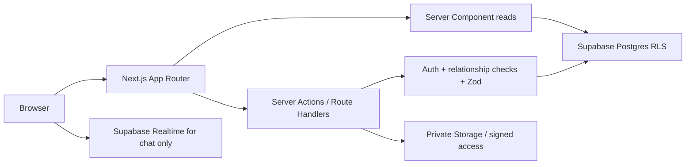

# Target architecture

The Laravel app is reference-only during implementation. Next.js pages render private data on the server with a request-scoped Supabase user client. Domain operations in `features/*/server` or `server/` validate Zod input, confirm Auth identity, confirm role and row relationship, write in a transaction when multiple tables/audit rows change, then revalidate the affected path. Browser clients are limited to interactive maps, chat, Kanban, notes editor, and browser-local tools. Route Handlers own authenticated downloads. Admin service-role use, if needed for account provisioning/migration, is isolated to server code and rechecks admin identity.

## Key design decisions to resolve in Phase 02
- Legacy `users.id` is bigint; Supabase Auth `auth.users.id` is UUID. Recommended: retain `public.users.id` as the legacy bigint application key and add `public.users.auth_user_id` UUID unique referencing `auth.users.id`. Supabase Auth owns password, recovery and MFA credentials; domain FKs continue to reference `public.users.id`. Confirm production data and import tooling before freezing this design. The RLS identity helper must map `auth.uid()` to `public.users.id` safely and without recursive policy checks.
- Do not assume the Supabase REST client can perform multi-table writes atomically. Use reviewed PostgreSQL functions or a server-side transactional connection for attendance → duty log, account → role/profile/requirements, assignment → audit, and cutover imports; document the chosen mechanism before code.
- Preserve nullable and legacy state semantics; use explicit check constraints or PostgreSQL enums only after confirming migrations and data values.
- RLS mirrors role *and* relationship. Admin broad read/write is limited by server authorization and policy; coordinator student ownership and assignment linkage must be checked. Keep security functions small and reviewed for recursion/security-definer behavior.

## Read/write paths
- Directory: admin maintains coordinator/professor/supervisor; coordinators maintain only their students; account creation spans Auth, profile, role, domain profile, requirements, audit.
- Assignment: coordinator manages owned student; internal requires professor and prohibits supervisor, external inverse. One assignment per student is a DB unique constraint.
- Attendance: only student creates own punches; final punch calculates rendered hours, upserts pending duty log. Reviewer approval is professor/supervisor linked to assignment, with `approved_by` and `approved_at`.
- Requirements: student marks submitted, coordinator receives physical copy and toggles completion. Completion does not gate attendance in existing UI.
- Evaluation: assignment-linked evaluator submits rubric; student downloads only own, evaluator only own file.
- Messaging: assignment/coordinator-linked participants; Realtime is genuinely useful here. A private channel must authorize both conversation participants.

See [FOLDER_STRUCTURE.md](FOLDER_STRUCTURE.md), [SECURITY.md](SECURITY.md), and [DATABASE_MIGRATION.md](DATABASE_MIGRATION.md) for implementation boundaries.
