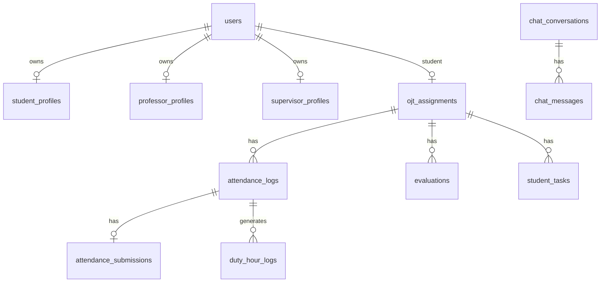

# Database schema from Laravel migrations

CONFIRMED: 29 tables are declared by `Schema::create` (including framework and Spatie tables). The declarations below transcribe the migration `up()` schema: `id()` is bigint primary key, `timestamps()` adds nullable `created_at`/`updated_at` timestamps, and `foreignId()` is unsigned bigint in Laravel. Each `nullable`, `default`, `unique`, `index`, FK action, and enum is retained in the declaration. Actual production DB constraints/values need Phase 00 inspection. No soft-delete columns were found.

## Domain relationships

## Tables

### `users`

- Purpose: Application identity and coordinator ownership.
- Laravel model: User.
- Migration: `../database/migrations/0001_01_01_001001_create_users_table.php`.
- Target: `public.users` with bigint `id` retained and new unique UUID `auth_user_id` referencing `auth.users.id`; Supabase Auth owns credentials. RLS: own profile; admin/coordinator scoped reads; restricted writes. CURRENT → TARGET: Laravel `password`/2FA secrets move to Auth-managed credentials or reset/re-enrolment; impact requires Phase 03/19 decision.
- Columns (declaration includes type, nullable/default, primary/unique/index/FK chains where inline):

  - `$table->id();`
  - `$table->string('first_name')->nullable();`
  - `$table->string('middle_name')->nullable();`
  - `$table->string('last_name')->nullable();`
  - `$table->string('contact_number')->nullable();`
  - `$table->string('name');`
  - `$table->string('email')->unique();`
  - `$table->timestamp('email_verified_at')->nullable();`
  - `$table->string('profile_photo_path')->nullable();`
  - `$table->string('status')->nullable();`
  - `$table->string('password');`
  - `$table->foreignId('coordinator_id') ->nullable() ->constrained('users') ->nullOnDelete();`
  - `$table->rememberToken();`
  - `$table->timestamps();`
  - `$table->text('two_factor_secret')->nullable();`
  - `$table->text('two_factor_recovery_codes')->nullable();`
  - `$table->timestamp('two_factor_confirmed_at')->nullable();`

### `password_reset_tokens`

- Purpose: Laravel password reset transport.
- Laravel model: —.
- Migration: `../database/migrations/0001_01_01_001001_create_users_table.php`.
- Target: no application table by default; Laravel-only `password_reset_tokens` is archived/excluded after production review. RLS: Target Supabase Auth handles; not copied.
- Columns (declaration includes type, nullable/default, primary/unique/index/FK chains where inline):

  - `$table->string('email')->primary();`
  - `$table->string('token');`
  - `$table->timestamp('created_at')->nullable();`

### `sessions`

- Purpose: Laravel sessions.
- Laravel model: —.
- Migration: `../database/migrations/0001_01_01_001001_create_users_table.php`.
- Target: no application table by default; Laravel-only `sessions` is archived/excluded after production review. RLS: Target Supabase Auth handles; not copied.
- Columns (declaration includes type, nullable/default, primary/unique/index/FK chains where inline):

  - `$table->string('id')->primary();`
  - `$table->foreignId('user_id')->nullable()->index();`
  - `$table->string('ip_address', 45)->nullable();`
  - `$table->text('user_agent')->nullable();`
  - `$table->longText('payload');`
  - `$table->integer('last_activity')->index();`

### `cache`

- Purpose: Laravel cache.
- Laravel model: —.
- Migration: `../database/migrations/0001_01_01_002001_create_cache_table.php`.
- Target: no application table by default; Laravel-only `cache` is archived/excluded after production review. RLS: Do not copy unless proven business data.
- Columns (declaration includes type, nullable/default, primary/unique/index/FK chains where inline):

  - `$table->string('key')->primary();`
  - `$table->mediumText('value');`
  - `$table->integer('expiration')->index();`

### `cache_locks`

- Purpose: Laravel cache locks.
- Laravel model: —.
- Migration: `../database/migrations/0001_01_01_002001_create_cache_table.php`.
- Target: no application table by default; Laravel-only `cache_locks` is archived/excluded after production review. RLS: Do not copy.
- Columns (declaration includes type, nullable/default, primary/unique/index/FK chains where inline):

  - `$table->string('key')->primary();`
  - `$table->string('owner');`
  - `$table->integer('expiration')->index();`

### `jobs`

- Purpose: Laravel queue.
- Laravel model: —.
- Migration: `../database/migrations/0001_01_01_003002_create_jobs_table.php`.
- Target: no application table by default; Laravel-only `jobs` is archived/excluded after production review. RLS: No custom jobs found; do not copy.
- Columns (declaration includes type, nullable/default, primary/unique/index/FK chains where inline):

  - `$table->id();`
  - `$table->string('queue')->index();`
  - `$table->longText('payload');`
  - `$table->unsignedTinyInteger('attempts');`
  - `$table->unsignedInteger('reserved_at')->nullable();`
  - `$table->unsignedInteger('available_at');`
  - `$table->unsignedInteger('created_at');`

### `job_batches`

- Purpose: Laravel queue batches.
- Laravel model: —.
- Migration: `../database/migrations/0001_01_01_003002_create_jobs_table.php`.
- Target: no application table by default; Laravel-only `job_batches` is archived/excluded after production review. RLS: Do not copy.
- Columns (declaration includes type, nullable/default, primary/unique/index/FK chains where inline):

  - `$table->string('id')->primary();`
  - `$table->string('name');`
  - `$table->integer('total_jobs');`
  - `$table->integer('pending_jobs');`
  - `$table->integer('failed_jobs');`
  - `$table->longText('failed_job_ids');`
  - `$table->mediumText('options')->nullable();`
  - `$table->integer('cancelled_at')->nullable();`
  - `$table->integer('created_at');`
  - `$table->integer('finished_at')->nullable();`

### `failed_jobs`

- Purpose: Laravel failed queue records.
- Laravel model: —.
- Migration: `../database/migrations/0001_01_01_003002_create_jobs_table.php`.
- Target: no application table by default; Laravel-only `failed_jobs` is archived/excluded after production review. RLS: Archive if operational retention requires; not app table.
- Columns (declaration includes type, nullable/default, primary/unique/index/FK chains where inline):

  - `$table->id();`
  - `$table->string('uuid')->unique();`
  - `$table->text('connection');`
  - `$table->text('queue');`
  - `$table->longText('payload');`
  - `$table->longText('exception');`
  - `$table->timestamp('failed_at')->useCurrent();`

### `permissions`

- Purpose: Spatie named permissions.
- Laravel model: Spatie Permission.
- Migration: `../database/migrations/2026_03_07_105601_create_permission_tables.php`.
- Target: `permissions` unless marked as Laravel-only above. RLS: Inspect production; no named grants seeded.
- Columns (declaration includes type, nullable/default, primary/unique/index/FK chains where inline):

  - `$table->id(); // permission id`
  - `$table->string('name');`
  - `$table->string('guard_name');`
  - `$table->timestamps();`

- Additional indexes/keys: `$table->unique(['name', 'guard_name']);`.

### `roles`

- Purpose: Spatie roles.
- Laravel model: Spatie Role.
- Migration: `../database/migrations/2026_03_07_105601_create_permission_tables.php`.
- Target: `roles` unless marked as Laravel-only above. RLS: Admin-only membership management.
- Columns (declaration includes type, nullable/default, primary/unique/index/FK chains where inline):

  - `$table->id(); // role id`
  - `$table->unsignedBigInteger($columnNames['team_foreign_key'])->nullable();`
  - `$table->string('name');`
  - `$table->string('guard_name');`
  - `$table->timestamps();`

- Additional indexes/keys: `$table->index($columnNames['team_foreign_key'], 'roles_team_foreign_key_index');`; `$table->unique([$columnNames['team_foreign_key'], 'name', 'guard_name']);`; `$table->unique(['name', 'guard_name']);`.

### `model_has_permissions`

- Purpose: Polymorphic direct permission pivot.
- Laravel model: —.
- Migration: `../database/migrations/2026_03_07_105601_create_permission_tables.php`.
- Target: `model_has_permissions` unless marked as Laravel-only above. RLS: Inspect production before deciding to retain.
- Columns (declaration includes type, nullable/default, primary/unique/index/FK chains where inline):

  - `$table->unsignedBigInteger($pivotPermission);`
  - `$table->string('model_type');`
  - `$table->unsignedBigInteger($columnNames['model_morph_key']);`
  - `$table->unsignedBigInteger($columnNames['team_foreign_key']);`

- Additional indexes/keys: `$table->index([$columnNames['model_morph_key'], 'model_type'], 'model_has_permissions_model_id_model_type_index');`; `$table->foreign($pivotPermission) ->references('id') // permission id ->on($tableNames['permissions']) ->cascadeOnDelete();`; `$table->index($columnNames['team_foreign_key'], 'model_has_permissions_team_foreign_key_index');`.

### `model_has_roles`

- Purpose: Polymorphic user-role pivot.
- Laravel model: User HasRoles.
- Migration: `../database/migrations/2026_03_07_105601_create_permission_tables.php`.
- Target: `model_has_roles` unless marked as Laravel-only above. RLS: Map to Auth-linked role membership; admin-only.
- Columns (declaration includes type, nullable/default, primary/unique/index/FK chains where inline):

  - `$table->unsignedBigInteger($pivotRole);`
  - `$table->string('model_type');`
  - `$table->unsignedBigInteger($columnNames['model_morph_key']);`
  - `$table->unsignedBigInteger($columnNames['team_foreign_key']);`

- Additional indexes/keys: `$table->index([$columnNames['model_morph_key'], 'model_type'], 'model_has_roles_model_id_model_type_index');`; `$table->foreign($pivotRole) ->references('id') // role id ->on($tableNames['roles']) ->cascadeOnDelete();`; `$table->index($columnNames['team_foreign_key'], 'model_has_roles_team_foreign_key_index');`.

### `role_has_permissions`

- Purpose: Role-permission pivot.
- Laravel model: —.
- Migration: `../database/migrations/2026_03_07_105601_create_permission_tables.php`.
- Target: `role_has_permissions` unless marked as Laravel-only above. RLS: Inspect production; no grants seeded.
- Columns (declaration includes type, nullable/default, primary/unique/index/FK chains where inline):

  - `$table->unsignedBigInteger($pivotPermission);`
  - `$table->unsignedBigInteger($pivotRole);`

- Additional indexes/keys: `$table->foreign($pivotPermission) ->references('id') // permission id ->on($tableNames['permissions']) ->cascadeOnDelete();`; `$table->foreign($pivotRole) ->references('id') // role id ->on($tableNames['roles']) ->cascadeOnDelete();`; `$table->primary([$pivotPermission, $pivotRole], 'role_has_permissions_permission_id_role_id_primary');`.

### `student_profiles`

- Purpose: Student number, course, required hours.
- Laravel model: StudentProfile.
- Migration: `../database/migrations/2026_04_10_042301_create_student_profiles_table.php`.
- Target: `student_profiles` unless marked as Laravel-only above. RLS: Own, coordinator owner, admin; role-scoped writes.
- Columns (declaration includes type, nullable/default, primary/unique/index/FK chains where inline):

  - `$table->id();`
  - `$table->foreignId('user_id') ->unique() ->constrained() ->cascadeOnDelete();`
  - `$table->string('student_id')->unique();`
  - `$table->string('course');`
  - `$table->unsignedInteger('ojt_required_hours')->default(0);`
  - `$table->timestamps();`

### `supervisor_profiles`

- Purpose: Company supervisor metadata.
- Laravel model: SupervisorProfile.
- Migration: `../database/migrations/2026_04_10_070343_create_supervisor_profiles_table.php`.
- Target: `supervisor_profiles` unless marked as Laravel-only above. RLS: Own and admin; admin writes.
- Columns (declaration includes type, nullable/default, primary/unique/index/FK chains where inline):

  - `$table->id();`
  - `$table->foreignId('user_id')->unique()->constrained()->cascadeOnDelete();`
  - `$table->string('supervisor_id')->unique();`
  - `$table->string('company_name');`
  - `$table->text('company_address')->nullable();`
  - `$table->timestamps();`

### `announcements`

- Purpose: Shared site announcements.
- Laravel model: Announcement.
- Migration: `../database/migrations/2026_04_10_072855_create_announcements_table.php`.
- Target: `announcements` unless marked as Laravel-only above. RLS: Authenticated read; admin writes.
- Columns (declaration includes type, nullable/default, primary/unique/index/FK chains where inline):

  - `$table->id();`
  - `$table->string('title');`
  - `$table->longText('message');`
  - `$table->string('type')->default('info');`
  - `$table->timestamps();`

### `professor_profiles`

- Purpose: Professor employee metadata.
- Laravel model: ProfessorProfile.
- Migration: `../database/migrations/2026_04_10_092354_create_professor_profiles_table.php`.
- Target: `professor_profiles` unless marked as Laravel-only above. RLS: Own and admin; admin writes.
- Columns (declaration includes type, nullable/default, primary/unique/index/FK chains where inline):

  - `$table->id();`
  - `$table->foreignId('user_id')->unique()->constrained()->cascadeOnDelete();`
  - `$table->string('employee_id')->unique();`
  - `$table->string('department');`
  - `$table->string('position');`
  - `$table->timestamps();`

### `audit_logs`

- Purpose: Selected mutation audit trail.
- Laravel model: AuditLog.
- Migration: `../database/migrations/2026_04_11_050629_create_audit_logs_table.php`.
- Target: `audit_logs` unless marked as Laravel-only above. RLS: Admin read/delete per current UI; server insert.
- Columns (declaration includes type, nullable/default, primary/unique/index/FK chains where inline):

  - `$table->id();`
  - `$table->foreignId('actor_id')->nullable()->constrained('users')->nullOnDelete();`
  - `$table->string('actor_name')->nullable();`
  - `$table->string('actor_role')->nullable();`
  - `$table->string('module');`
  - `$table->string('action');`
  - `$table->string('target_type')->nullable();`
  - `$table->unsignedBigInteger('target_id')->nullable();`
  - `$table->string('target_label')->nullable();`
  - `$table->text('description')->nullable();`
  - `$table->json('old_values')->nullable();`
  - `$table->json('new_values')->nullable();`
  - `$table->json('meta')->nullable();`
  - `$table->ipAddress('ip_address')->nullable();`
  - `$table->text('user_agent')->nullable();`
  - `$table->timestamps();`

- Additional indexes/keys: `$table->index(['module', 'action']);`; `$table->index(['target_type', 'target_id']);`; `$table->index('created_at');`.

### `ojt_assignments`

- Purpose: One placement per student.
- Laravel model: OjtAssignment.
- Migration: `../database/migrations/2026_04_11_060258_create_ojt_assignments_table.php`.
- Target: `ojt_assignments` unless marked as Laravel-only above. RLS: Student/owner coordinator/assigned staff/admin reads; coordinator writes.
- Columns (declaration includes type, nullable/default, primary/unique/index/FK chains where inline):

  - `$table->id();`
  - `$table->foreignId('student_id')->constrained('users')->cascadeOnDelete();`
  - `$table->enum('ojt_type', ['internal', 'external']);`
  - `$table->foreignId('professor_id')->nullable()->constrained('users')->nullOnDelete();`
  - `$table->foreignId('company_supervisor_id')->nullable()->constrained('users')->nullOnDelete();`
  - `$table->enum('status', ['pending', 'active', 'completed', 'cancelled'])->default('active');`
  - `$table->text('remarks')->nullable();`
  - `$table->timestamps();`

- Additional indexes/keys: `$table->unique('student_id');`.

### `attendance_logs`

- Purpose: Daily four-punch attendance and location.
- Laravel model: AttendanceLog.
- Migration: `../database/migrations/2026_04_11_060332_create_attendance_logs_table.php`.
- Target: `attendance_logs` unless marked as Laravel-only above. RLS: Own student writes; linked staff/coordinator/admin reads.
- Columns (declaration includes type, nullable/default, primary/unique/index/FK chains where inline):

  - `$table->id();`
  - `$table->foreignId('student_id')->constrained('users')->cascadeOnDelete();`
  - `$table->foreignId('ojt_assignment_id')->constrained('ojt_assignments')->cascadeOnDelete();`
  - `$table->foreignId('reviewed_by')->nullable()->constrained('users')->nullOnDelete();`
  - `$table->decimal('hours_rendered', 5, 2)->default(0);`
  - `$table->boolean('overtime_enabled')->default(false);`
  - `$table->date('attendance_date');`
  - `$table->timestamp('morning_time_in')->nullable();`
  - `$table->timestamp('morning_time_out')->nullable();`
  - `$table->timestamp('afternoon_time_in')->nullable();`
  - `$table->timestamp('afternoon_time_out')->nullable();`
  - `$table->decimal('time_in_latitude', 10, 7)->nullable();`
  - `$table->decimal('time_in_longitude', 10, 7)->nullable();`
  - `$table->unsignedInteger('time_in_location_accuracy')->nullable();`
  - `$table->enum('status', ['present', 'late', 'absent', 'incomplete'])->default('present');`
  - `$table->text('remarks')->nullable();`
  - `$table->timestamps();`

- Additional indexes/keys: `$table->unique(['student_id', 'attendance_date']);`; `$table->index(['attendance_date', 'status']);`.

### `duty_hour_logs`

- Purpose: Rendered and reviewer-approved hours.
- Laravel model: DutyHourLog.
- Migration: `../database/migrations/2026_04_11_060343_create_duty_hour_logs_table.php`.
- Target: `duty_hour_logs` unless marked as Laravel-only above. RLS: Own student reads; linked reviewer writes; admin/coordinator monitors.
- Columns (declaration includes type, nullable/default, primary/unique/index/FK chains where inline):

  - `$table->id();`
  - `$table->foreignId('student_id')->constrained('users')->cascadeOnDelete();`
  - `$table->foreignId('ojt_assignment_id')->constrained('ojt_assignments')->cascadeOnDelete();`
  - `$table->foreignId('attendance_log_id')->nullable()->constrained('attendance_logs')->nullOnDelete();`
  - `$table->date('log_date');`
  - `$table->decimal('hours_rendered', 5, 2)->default(0);`
  - `$table->decimal('approved_hours', 5, 2)->default(0);`
  - `$table->enum('status', ['pending', 'approved', 'rejected'])->default('pending');`
  - `$table->text('remarks')->nullable();`
  - `$table->foreignId('approved_by')->nullable()->constrained('users')->nullOnDelete();`
  - `$table->timestamp('approved_at')->nullable();`
  - `$table->timestamps();`

- Additional indexes/keys: `$table->index(['log_date', 'status']);`.

### `evaluations`

- Purpose: Submitted practicum rubric.
- Laravel model: Evaluation.
- Migration: `../database/migrations/2026_04_11_071159_create_evaluations_table.php`.
- Target: `evaluations` unless marked as Laravel-only above. RLS: Own student/evaluator/admin reads; assigned evaluator inserts.
- Columns (declaration includes type, nullable/default, primary/unique/index/FK chains where inline):

  - `$table->id();`
  - `$table->foreignId('student_id')->constrained('users')->cascadeOnDelete();`
  - `$table->foreignId('ojt_assignment_id')->constrained('ojt_assignments')->cascadeOnDelete();`
  - `$table->foreignId('evaluator_id')->constrained('users')->cascadeOnDelete();`
  - `$table->enum('evaluator_type', ['professor', 'company_supervisor']);`
  - `$table->date('evaluation_date')->nullable();`
  - `$table->decimal('rating', 5, 2)->default(0);`
  - `$table->text('remarks')->nullable();`
  - `$table->enum('status', ['pending', 'submitted', 'reviewed'])->default('pending');`
  - `$table->timestamps();`
  - `$table->date('inclusive_from')->nullable();`
  - `$table->date('inclusive_to')->nullable();`
  - `$table->string('cooperating_program')->nullable();`
  - `$table->json('ratings')->nullable();`

- Additional indexes/keys: `$table->index(['status', 'evaluation_date']);`.

### `student_tasks`

- Purpose: Assigned Kanban items.
- Laravel model: StudentTask.
- Migration: `../database/migrations/2026_05_08_0345798_create_student_tasks_table.php`.
- Target: `student_tasks` unless marked as Laravel-only above. RLS: Student and assigning linked staff reads/writes.
- Columns (declaration includes type, nullable/default, primary/unique/index/FK chains where inline):

  - `$table->id();`
  - `$table->foreignId('student_id')->constrained('users')->cascadeOnDelete();`
  - `$table->foreignId('assigned_by')->constrained('users')->cascadeOnDelete();`
  - `$table->foreignId('ojt_assignment_id')->nullable()->constrained('ojt_assignments')->nullOnDelete();`
  - `$table->uuid('task_group_id')->nullable();`
  - `$table->string('title');`
  - `$table->text('description')->nullable();`
  - `$table->enum('status', ['pending', 'in_progress', 'in_review', 'done'])->default('pending');`
  - `$table->enum('priority', ['low', 'normal', 'high'])->default('normal');`
  - `$table->date('due_date')->nullable();`
  - `$table->unsignedInteger('sort_order')->default(0);`
  - `$table->timestamp('completed_at')->nullable();`
  - `$table->timestamps();`

- Additional indexes/keys: `$table->index(['status', 'sort_order']);`; `$table->index(['student_id', 'status']);`; `$table->index(['assigned_by', 'status']);`; `$table->index(['task_group_id', 'status']);`.

### `chat_conversations`

- Purpose: Student-to-contact conversation.
- Laravel model: ChatConversation.
- Migration: `../database/migrations/2026_05_08_0345800_create_chat_conversations_table.php`.
- Target: `chat_conversations` unless marked as Laravel-only above. RLS: Only student and participant read/write.
- Columns (declaration includes type, nullable/default, primary/unique/index/FK chains where inline):

  - `$table->id();`
  - `$table->foreignId('ojt_assignment_id')->nullable()->constrained('ojt_assignments')->cascadeOnDelete();`
  - `$table->foreignId('student_id')->constrained('users')->cascadeOnDelete();`
  - `$table->foreignId('participant_id')->constrained('users')->cascadeOnDelete();`
  - `$table->enum('participant_role', ['professor', 'supervisor', 'coordinator']);`
  - `$table->timestamps();`

- Additional indexes/keys: `$table->unique(['ojt_assignment_id', 'participant_id', 'participant_role'], 'chat_conversation_unique');`; `$table->index(['student_id', 'participant_role']);`; `$table->index(['participant_id', 'participant_role']);`.

### `chat_messages`

- Purpose: Conversation messages/read/edit state.
- Laravel model: ChatMessage.
- Migration: `../database/migrations/2026_05_08_0345801_create_chat_messages_table.php`.
- Target: `chat_messages` unless marked as Laravel-only above. RLS: Participants read; sender writes own; read receipt by recipient.
- Columns (declaration includes type, nullable/default, primary/unique/index/FK chains where inline):

  - `$table->id();`
  - `$table->foreignId('chat_conversation_id')->constrained('chat_conversations')->cascadeOnDelete();`
  - `$table->foreignId('sender_id')->constrained('users')->cascadeOnDelete();`
  - `$table->text('body');`
  - `$table->timestamp('read_at')->nullable();`
  - `$table->timestamps();`
  - `$table->timestamp('edited_at')->nullable();`

- Additional indexes/keys: `$table->index(['chat_conversation_id', 'created_at']);`; `$table->index(['sender_id', 'created_at']);`; `$table->index(['read_at']);`.

### `chat_typing_indicators`

- Purpose: Ephemeral three-second typing state.
- Laravel model: ChatTypingIndicator.
- Migration: `../database/migrations/2026_05_08_0345802_create_chat_typing_indicators_table.php`.
- Target: `chat_typing_indicators` unless marked as Laravel-only above. RLS: Participants only; consider Realtime presence replacement.
- Columns (declaration includes type, nullable/default, primary/unique/index/FK chains where inline):

  - `$table->id();`
  - `$table->foreignId('chat_conversation_id')->constrained('chat_conversations')->cascadeOnDelete();`
  - `$table->foreignId('user_id')->constrained('users')->cascadeOnDelete();`
  - `$table->timestamp('expires_at');`
  - `$table->timestamps();`

- Additional indexes/keys: `$table->unique(['chat_conversation_id', 'user_id'], 'chat_typing_unique');`; `$table->index(['chat_conversation_id', 'expires_at']);`.

### `student_requirements`

- Purpose: Nine physical requirement checklist rows.
- Laravel model: StudentRequirement.
- Migration: `../database/migrations/2026_05_08_058734_create_student_requirements_table.php`.
- Target: `student_requirements` unless marked as Laravel-only above. RLS: Student read/submit; coordinator owner complete.
- Columns (declaration includes type, nullable/default, primary/unique/index/FK chains where inline):

  - `$table->id();`
  - `$table->foreignId('student_id')->constrained('users')->cascadeOnDelete();`
  - `$table->string('key');`
  - `$table->string('label');`
  - `$table->string('step');`
  - `$table->unsignedSmallInteger('sort_order')->default(0);`
  - `$table->string('template_path')->nullable();`
  - `$table->boolean('is_completed')->default(false);`
  - `$table->timestamp('submitted_at')->nullable();`
  - `$table->timestamp('completed_at')->nullable();`
  - `$table->foreignId('completed_by')->nullable()->constrained('users')->nullOnDelete();`
  - `$table->timestamps();`

- Additional indexes/keys: `$table->unique(['student_id', 'key']);`.

### `student_notes`

- Purpose: Private student notes.
- Laravel model: StudentNote.
- Migration: `../database/migrations/2026_05_09_0234823_create_student_notes_table.php`.
- Target: `student_notes` unless marked as Laravel-only above. RLS: Owner only.
- Columns (declaration includes type, nullable/default, primary/unique/index/FK chains where inline):

  - `$table->id();`
  - `$table->foreignId('student_id')->constrained('users')->cascadeOnDelete();`
  - `$table->string('title')->default('Untitled Note');`
  - `$table->longText('body')->nullable();`
  - `$table->boolean('is_pinned')->default(false);`
  - `$table->timestamps();`

- Additional indexes/keys: `$table->index(['student_id', 'is_pinned', 'updated_at']);`.

### `attendance_submissions`

- Purpose: Daily accomplishment and photo paths.
- Laravel model: AttendanceSubmission.
- Migration: `../database/migrations/2026_05_13_000001_create_attendance_submissions_table.php`.
- Target: `attendance_submissions` unless marked as Laravel-only above. RLS: Owner write; linked staff read.
- Columns (declaration includes type, nullable/default, primary/unique/index/FK chains where inline):

  - `$table->id();`
  - `$table->foreignId('attendance_log_id')->constrained('attendance_logs')->cascadeOnDelete();`
  - `$table->foreignId('student_id')->constrained('users')->cascadeOnDelete();`
  - `$table->foreignId('ojt_assignment_id')->constrained('ojt_assignments')->cascadeOnDelete();`
  - `$table->text('accomplishment')->nullable();`
  - `$table->json('photo_paths')->nullable();`
  - `$table->timestamps();`

- Additional indexes/keys: `$table->unique('attendance_log_id');`; `$table->index(['student_id', 'created_at']);`.

## Cross-migration and model details

- `2026_05_11_000001` adds evaluation inclusive dates, cooperating program and JSON ratings; `2026_05_13_000002` adds chat `edited_at`; `2026_05_13_000003` makes conversation assignment nullable and allows coordinator role, with driver-specific migration behavior. Confirm actual production DDL.
- `config/permission.php` sets Spatie table names with `teams = false` in this repository; the migration also has dormant optional teams branches. The migration has polymorphic `model_type`/`model_id` pivots, not simple user-only FKs. Teams configuration must be checked before mapping.
- JSON/array casts: `Evaluation.ratings`, `AuditLog.old_values/new_values/meta`, `AttendanceSubmission.photo_paths`; datetime/date casts in attendance, duty, evaluation, task and chat models. `hours_rendered` and `approved_hours` are decimal(5,2).
- There is no soft delete in migrations/models. `users.coordinator_id` self-FK nulls on coordinator deletion; deleting a student cascades to assignment, logs, evaluation, tasks, chat, notes, requirements and submissions according to their FK chains.
- `student_profiles.student_id` is a string student number, distinct from `users.id` bigint. Do not conflate them during migration.
- The target schema must document CURRENT → TARGET → WHY → MIGRATION IMPACT for any conversion, especially bigint ID mapping, enum/check choices, Auth-owned tables, and private file paths.
- `attendance_logs.reviewed_by` is declared and related by the model, but no routed attendance review mutation was found. Do not invent an attendance approval workflow from this column alone. `AttendanceLog::isComplete()` checks only `afternoon_time_out`, while report submission query requires all four punch fields; preserve the stricter report criterion.
