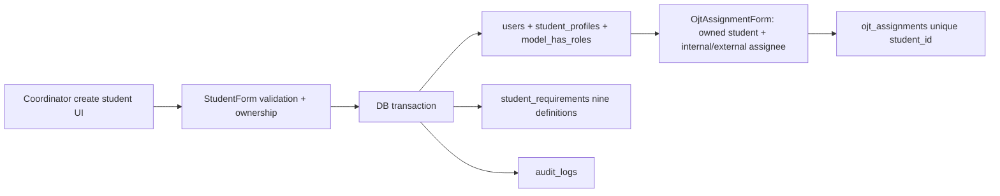
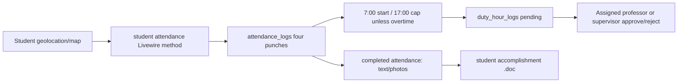
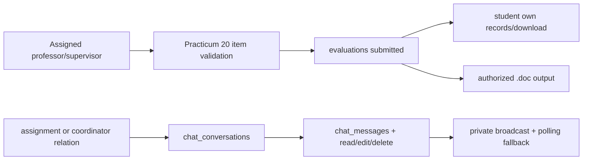

# Feature inventory and end-to-end traces

CONFIRMED features are evidenced by routed code unless marked otherwise. Paths below are relative to Laravel root. `P` = page in `resources/views/pages/`, `F` = form/component, `M` = model. Each row states users, route/page, write path, tables, key rule/edge, and target. No generic `app/Services`, Policies, Jobs, Exports or Imports implementations exist.

| Feature | Users / route / Laravel path | Data, validation, rule and target | Complexity |
|---|---|---|---|
| Landing | Public `/`; `resources/views/welcome.blade.php`, landing components | Static marketing/team/FAQ/bug-report UI; no persisted bug-report endpoint found. Server page and static assets. | Low |
| Login, register, reset, email verification, 2FA | All; Fortify routes, `app/Providers/FortifyServiceProvider.php`, `app/Actions/Fortify/*`, auth views | `users`, tokens/sessions, 2FA secret. Login/2FA rate 5/min. Registration currently roleless; `MustVerifyEmail` commented. Supabase Auth mapping; review parity before changing. | High |
| Settings/profile/password/appearance/account deletion/2FA | Auth; `/settings/*`, `resources/views/pages/settings/*` | `users`, Auth credentials; profile/email validation, password confirmation; client appearance. Supabase Auth + profile actions. | Medium |
| Role dashboard redirect and five dashboards | Auth; `/dashboard`, each `*/dashboard` | Counts/trends based on users, assignment, attendance, duty logs, evaluations; role-specific query scope, pagination. Server dashboard queries. | Medium |
| Admin account directory | Admin `/admin/{students,coordinators,professors,supervisors}`; `P/admin/*`, `F/admin/*`, `app/Livewire/Forms/Admin/*` | Admin views students and CRUD staff (not student create on admin page); `users`, profile tables, roles, `audit_logs`, profile photos. Validate unique email/IDs and image size; preserve audit. | High |
| Coordinator student management | Coordinator `/coordinator/student-management`; `P/coordinator/*`, `F/coordinator/student-management/*`, `app/Livewire/Forms/Coordinator/StudentForm.php`, `StudentDirectory` | Own `users.coordinator_id`; `student_profiles`, `student_requirements`, roles, audit, photos. Create/update/delete only managed students, unique student ID/email, required hours ≥0. Directory autofill; legacy default password is last name, min 3—review. | High |
| Staff directory autofill | Admin staff forms; `app/Support/StaffDirectory.php` | Embedded reference records; account creation/updating. Target server-only reviewed data path; duplicate/conflicting IDs and privacy need validation. | Medium |
| Assignment management | Coordinator `/coordinator/ojt-assignments`, admin read monitor; `app/Livewire/Forms/Coordinator/OjtAssignmentForm.php`, `F/coordinator/ojt-assignments/*`, `P/*/ojt-assignments/*` | `ojt_assignments`, `audit_logs`; one per student; internal requires professor, external supervisor, other prohibited; status pending/active/completed/cancelled; own student only. Target transaction, unique constraint, scoped RLS. | High |
| Physical requirement checklist | Student dashboard `submitRequirement`, coordinator `/coordinator/requirements` and student modal; `StudentRequirement.php`, `F/coordinator/student-management/⚡requirements.blade.php` | `student_requirements`; nine active definitions, static templates in `public/requirements`; student marks submitted once, coordinator toggles received/completed. Pending requirements do not block OJT. | Medium |
| Attendance capture and location | Student `/student/attendance`; `P/student/⚡attendance/*`, map components, `AttendanceLog.php` | `attendance_logs`; one per student/date, four ordered punches, first punch requires lat/lon, optional accuracy, 7:00 start, 17:00 cap unless overtime, late after 7:00. Browser geolocation + Leaflet/OSM. Target atomic server mutation; validate trust boundary. | High |
| Attendance bypass | Student attendance `bypassAttendance(60|480)` | LEGACY BEHAVIOR: any student with assignment can produce 1h or 8h synthetic complete day and pending duty log; test labels it 'for testing'. Do not silently expose in production target; decision gate in Phase 09. | High |
| Attendance monitoring | Admin/coordinator `/.../attendance`; `P/admin/⚡attendance/*`, `P/coordinator/⚡attendance/*` | Read/filter date/status/type/supervisor, summary and pagination; coordinator scopes own students. No edit action found. | Medium |
| Duty hour approval and monitoring | Student, professor, supervisor, coordinator, admin `/.../duty-hours`; pages, `DutyHourLog.php` | Attendance completion upserts `duty_hour_logs` pending. Professor/supervisor assigned rows approve full rendered hours or reject to zero; reviewer/time recorded. Admin/coordinator read monitor. **Test suggests coordinator duty monitor currently all students**—confirm intended scope; status transition allows repeat action. | High |
| Daily accomplishment submissions | Student `/student/reports-submissions`; `P/student/⚡reports-submissions/*`, `AttendanceSubmission.php` | Only attendance with all four punches; one submission/attendance, optional 5000-char text, up to 6 new images per save, each ≤4 MB; existing images append, so cumulative count can exceed six. Target private Storage, ownership validation. | High |
| Staff submission review | Professor/supervisor `/.../reports-submissions`; `P/*/⚡reports-submissions/*`, shared table | Read assigned student's completed attendance/submissions; no approval workflow found. | Medium |
| Accomplishment export | Student `/student/reports-submissions/download`; `AccomplishmentReportDocument.php`, export Blade | Own completed attendance, optional from/to filters, hours sum, embedded photos, HTML `.doc` response. Route currently parses query dates without explicit validation. Target authorized handler and output parity. | Medium |
| Practicum evaluation | Professor/supervisor `/.../evaluations`; `ManagesPracticumEvaluations.php`, `PracticumEvaluationForm.php`, `Evaluation.php` | Assigned evaluator, 20 rubric scores 1–5 in four areas, inclusive date range, total out of 100, status submitted. Multiple evaluations per assignment appear allowed. Student/admin read. Target form + row scope. | High |
| Evaluation download | Student/professor/supervisor `.../evaluations/{id}/download`; `EvaluationDocument.php`, export Blade | Student own or evaluator own/type; HTML `.doc` with logo and grade conversion. No admin export route. | Medium |
| Assigned tasks / Kanban | Professor/supervisor `/.../tasks`, student `/student/tasks`; pages + `StudentTask.php` | Staff assign to one/many assigned students, group UUID, priority/due date; staff and student reorder/change status among pending/in_progress/in_review/done, done sets completed_at. Scoped by student/assignment/assigner. | High |
| Private notes | Student `/student/notes`; `P/student/⚡notes/*`, `StudentNote.php` | Own CRUD, autosave title/body (20k), pin, search; no sharing. | Low |
| Messaging and typing | Student/coordinator/professor/supervisor `/.../messages`; `P/⚡messages.blade.php`, chat models, events, `routes/channels.php`, `resources/js/echo.js` | Conversations auto-created for coordinator even before assignment, professor/supervisor via assignment. Participants send ≤2000 chars, read/edit/delete own, typing TTL 3 sec, Reverb broadcast and polling. Target private Realtime + RLS. | High |
| Announcements | Admin `/admin/announcements`, all authenticated `/announcements` and shared banner; admin form, Announcement model | CRUD/admin; type info/warning/urgent/maintenance, audit; other roles read. No mail/push dispatch found. | Medium |
| Audit logs | Admin `/admin/audit-logs`; `AuditLogger.php`, page/component | Filter/sort/view/delete entries. Selected account, assignment, announcement writes log old/new values and actor metadata. No universal event listener. Target transaction and admin-only RLS. | Medium |
| Pomodoro | Student `/student/pomodoro`; Blade Alpine | Client timer/session settings and progress stored in localStorage key `student-pomodoro-state`; no DB. Small Client Component/local storage. | Low |
| Pet streak | Student `/student/pet`; Blade Alpine | Client care/streak/reward state in localStorage key `student-pet-streak-state`; no DB. Small Client Component/local storage. | Low |
| Unrouted partners page | `P/admin/⚡partners/*` exists, no `routes/web.php` route | OPEN QUESTION: orphan/unrouted feature; do not add navigation without product decision. | Low |
| Notifications/email/jobs/Excel | Fortify email flows; no app notification/job/export/import classes | Auth emails are framework behavior; no custom announcement/task alerts, scheduled job, or Excel export proven. Do not invent them. | Low |

## Feature data and side-effect map

Unless a row states otherwise, **Notifications: none**, **Jobs: none**, and **Exports: none** are confirmed from application code. Auth reset/verification emails are Fortify framework flows; the installed Excel package has no active export. The UI/route/form paths and complexity for each item are in the inventory above. Target operations belong to the matching `features/<domain>/server` module, with a Server Action for mutations and Route Handler for downloads. The following table makes the model/table, validation, dependency and side-effect contract explicit.

| Feature | Models → tables | Validation / authorization / edge | Side effects and target dependency |
|---|---|---|---|
| Landing | None | Public view; bug-report element has no observed persisted endpoint. | Static assets only. |
| Fortify auth/settings | User → `users`, Laravel token/session tables | Email/password, rate limits, password confirmation/2FA; registration creates roleless user. | Auth emails; target Supabase Auth and `public.users.auth_user_id`; password/MFA import decision. |
| Admin staff CRUD | User, ProfessorProfile, SupervisorProfile → `users`, `professor_profiles`, `supervisor_profiles`, `model_has_roles` | Admin role, unique email/employee/supervisor IDs, photos, required fields. | `audit_logs`, public-disk profile photo; target Auth provisioning/private Storage. |
| Coordinator student CRUD | User, StudentProfile, StudentRequirement → `users`, `student_profiles`, `student_requirements`, role pivot | Coordinator owner, unique student/email, hours ≥0, photo ≤2 MB, password min 3 (staff forms min 2). | Nine requirements, audit, photo; target transaction and reviewed directory data. |
| Directory autofill | `StudentDirectory`, `StaffDirectory` constants, no DB | Lookup by student/employee ID; source includes duplicate student IDs and generated/default email/password behavior. | No external API; target restricted server data source after privacy review. |
| Assignment | OjtAssignment → `ojt_assignments` | Own student, unique student, internal professor XOR external supervisor, valid roles/status. | Audit; prerequisite for attendance/reviewer/tasks/chat/evaluations. |
| Requirements | StudentRequirement → `student_requirements` | Own student submitted marker; coordinator owner completes physical copy; unique student/key. | Static `public/requirements` templates; no upload. |
| Attendance and bypass | AttendanceLog, DutyHourLog → `attendance_logs`, `duty_hour_logs` | Own assigned student, coordinates -90..90/-180..180, four punches, unique day, bypass 60/480 legacy action. | Final punch creates pending duty; Leaflet/OSM and browser geolocation; atomic transaction. |
| Attendance monitors | AttendanceLog → `attendance_logs` | Admin all; coordinator own-student scope; filter type/status/date/assignee. | Read-only summaries and pagination. |
| Duty approvals/monitors | DutyHourLog → `duty_hour_logs` | Assigned professor/supervisor approve/reject; student own read; coordinator duty monitor currently broad. | Reviewer/time/approved hours update; dashboard totals. |
| Daily submission | AttendanceSubmission, AttendanceLog → `attendance_submissions`, `attendance_logs` | Student own fully completed attendance, text ≤5000, ≤6 new photos/save each ≤4 MB. | Public-disk `accomplishment-photos`; target private Storage. |
| Staff report review | AttendanceSubmission → `attendance_submissions` | Professor/supervisor assignment scope. | Read-only shared table; no approval notification. |
| Accomplishment `.doc` | AttendanceLog, AttendanceSubmission → same tables | Student route own data; optional date query currently parsed without explicit validation. | HTML Word-compatible export with base64 photos, hours sum; target authorized handler. |
| Evaluations and `.doc` | Evaluation, OjtAssignment → `evaluations`, `ojt_assignments` | Assigned evaluator, 20 integer scores 1–5, inclusive date order; student/evaluator download scope. | Submitted record, grade equivalence, Word-compatible document; no alert. |
| Staff tasks | StudentTask, OjtAssignment → `student_tasks`, `ojt_assignments` | Assigned students only; title ≤255, description ≤5000, priority enum, due date; group card reorder. | Group UUID and per-student rows; no notification. |
| Student tasks | StudentTask → `student_tasks` | Own rows, valid four statuses, position clamped, done timestamp. | Reorder transaction. |
| Student notes | StudentNote → `student_notes` | Own CRUD, title ≤255, body ≤20000, pin/search. | Autosave; no sharing. |
| Messaging | ChatConversation, ChatMessage, ChatTypingIndicator → three chat tables | Student/participant only; message ≤2000; own edit/delete; coordinator pre-assignment conversation. | Reverb events and 3-second typing state; target private Realtime plus fallback. |
| Announcements | Announcement → `announcements` | Admin CRUD; type in info/warning/urgent/maintenance; authenticated read. | Audit log; no mail/push. |
| Audit | AuditLog → `audit_logs` | Admin list/filter/view/delete; allowed sort columns; actor may be null after deletion. | Selective log from account/assignment/announcement flows; no global listener. |
| Pomodoro / pet | No model/table | Student route only; browser state persisted with two localStorage keys. | Client-only widgets; no job or server table. |
| Unrouted partners | ProfessorProfile/User if ever routed | OPEN QUESTION: file exists but no route; do not treat as an active feature without evidence. | No target route planned. |

## Required flow traces

Source tests in `tests/Feature/` cover account/assignment/attendance/messages/evaluation flows and serve as parity fixtures; coverage is incomplete for task moves, RLS (not yet present), and production data.
